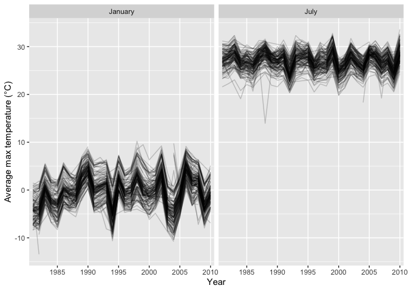
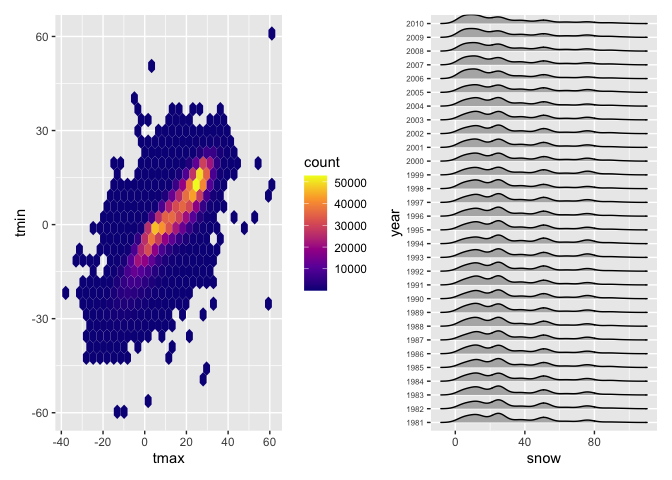

P8105 HW 3
================
Isabella Nguyen
2026-10-15

### Set up

``` r
library(tidyverse)
```

    ## ── Attaching core tidyverse packages ──────────────────────── tidyverse 2.0.0 ──
    ## ✔ dplyr     1.2.1     ✔ readr     2.2.0
    ## ✔ forcats   1.0.1     ✔ stringr   1.6.0
    ## ✔ ggplot2   4.0.3     ✔ tibble    3.3.1
    ## ✔ lubridate 1.9.5     ✔ tidyr     1.3.2
    ## ✔ purrr     1.2.2     
    ## ── Conflicts ────────────────────────────────────────── tidyverse_conflicts() ──
    ## ✖ dplyr::filter() masks stats::filter()
    ## ✖ dplyr::lag()    masks stats::lag()
    ## ℹ Use the conflicted package (<http://conflicted.r-lib.org/>) to force all conflicts to become errors

``` r
library(hexbin)
library(ggridges)
library(patchwork)
```

### Problem 1

``` r
library(p8105.datasets)
data("ny_noaa")
```

The NOAA dataset has 7 columns and 2595176 rows. The first column id
gives the station ID’s in NY, in which there are a total of 747 unique
stations. date gives us the date of a specific observation of `snow`
(snowfall in mm), `snwd` (snow depth in mm), `prcp` (precipiation in
tenths of a mm), `tmax` (the maximum temperature that day in tenths of a
degree celsius), and `tmin` (the minimum temperature that day n tenths
of a degree Celsius). There is a large amount of missing data in tmax
and tmin, where 43.7% of tmax and 43.7% of tmin are na values. There is
also missing data in prcp, snow, and snwd.

**Data Cleaning**

``` r
clean_noaa = 
  ny_noaa |>
  janitor::clean_names() |>
  separate(date, into = c("year","month","day"), sep = "-") |>
  mutate(
    prcp = prcp / 10,
    tmax = as.numeric(tmax) / 10,
    tmin = as.numeric(tmin) / 10
  )
```

To clean, I ensured clean names, separated date into year, month, and
day using the `separate` function, and made sure that precipitation is
in mm instead of tenths of a mm to match snow and swd. tmax and tmin
were converted to Celsius instead of tenths of a Celsius as well. The
most common value for snowfall is 0, since snowfall only occurs in the
winter and this data set contains observations in all months of a year.
This was found using `clean_noaa |> count(snow, sort = TRUE)` in the
console.

**Two panel plots**

``` r
#avg ax temp in january and july in eac station
clean_noaa |>
  filter(month == "01" | month == "07") |>
  group_by(id, year, month) |>
  summarize(avg_tmx = mean(tmax, na.rm = TRUE)) |>
ggplot(aes(x = year, y = avg_tmx)) +
  geom_line(aes(group = id), alpha = 0.2, na.rm = TRUE) + 
  facet_grid(. ~ month,
           labeller = as_labeller(c(`01` = "January", `07` = "July"))) +
  scale_x_discrete(breaks=as.character(seq(1980,2010, by = 5))) +
  labs(
    x = "Year",
    y = "Average max temperature (\u00B0C)"
  )
```

    ## `summarise()` has regrouped the output.
    ## ℹ Summaries were computed grouped by id, year, and month.
    ## ℹ Output is grouped by id and year.
    ## ℹ Use `summarise(.groups = "drop_last")` to silence this message.
    ## ℹ Use `summarise(.by = c(id, year, month))` for per-operation grouping
    ##   (`?dplyr::dplyr_by`) instead.

<!-- --> For this
plot of average max temperature by year, the clean data set was filtered
to only include data points from January and July. The `group_by`
function is used to group our data by id, year, and month – the
variables necessary to identify our groups. We then use summarize to get
the average max temperature for each id-year-month group. ggplot +
geom_line was then used to create a line plot and facet grid used to
separate the plot by month. scale_x_discrete was used for readability/
aesthetic purposes.

``` r
temp_plot = 
  clean_noaa |>
    ggplot(aes(x = tmax, y = tmin)) + 
    geom_hex(na.rm = TRUE) +
    scale_fill_viridis_c(option = "plasma")

snow_plot = 
  clean_noaa |>
    filter(snow > 0 , snow < 100) |> 
    ggplot(aes(x = snow, y = year)) + 
    geom_density_ridges(scale = 0.70) + 
 theme(axis.text.y = element_text(size = 6))

temp_plot + snow_plot
```

    ## Picking joint bandwidth of 3.76

<!-- --> For the
temp_plot, a hexbin was created to model tmax vs tmin. snow fall
distribution by year was modeled using a ridge plot. packages `hexbin`
and `ggridges` both had to be called for this. we use the `patchwork`
package to make our plots lay side by side.
